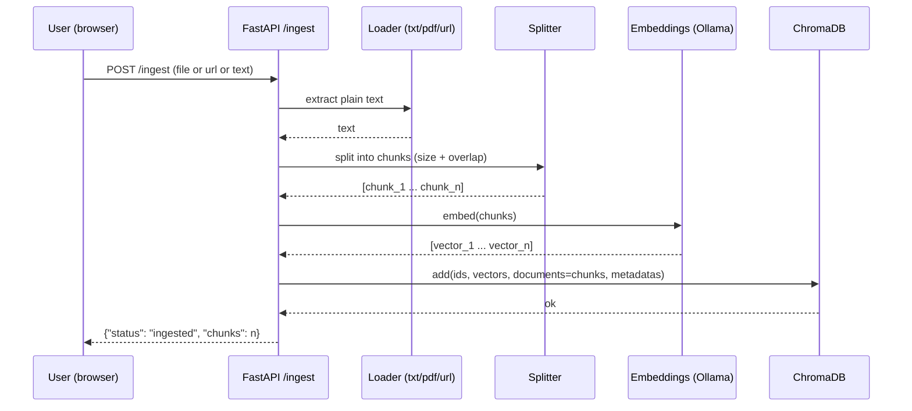
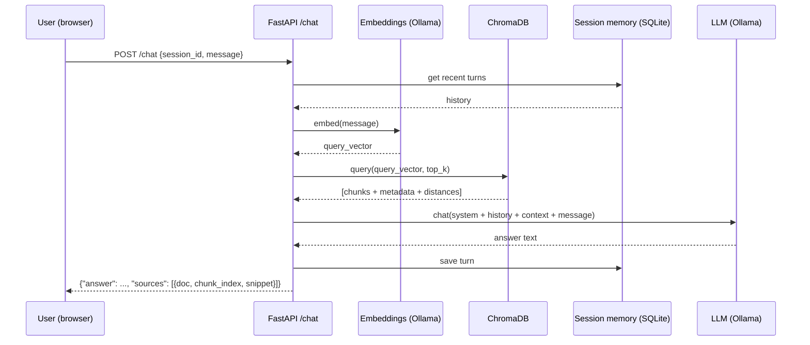

# ARCHITECTURE.md

## Ingestion sequence

## Chat sequence

## Component responsibilities

### `src/api/main.py`
FastAPI app factory, serves the static UI at `/`, mounts routers, runs a
startup check that Ollama is reachable.

### `src/api/ingest.py`
- `POST /ingest/file`: accepts a file upload, dispatches to the right
  loader by extension.
- `POST /ingest/url`: fetches and cleans a web page, ingests it.
- `POST /ingest/text`: ingests raw pasted text with a user-given title.
- `GET /documents`: lists ingested documents and chunk counts.
- `DELETE /documents/{doc_id}`: removes a document and its chunks.

### `src/api/chat.py`
- `POST /chat`: the RAG endpoint described above.
- `GET /chat/{session_id}/history`: returns saved turns for a session.
- `DELETE /chat/{session_id}`: clears a session's history.

### `src/ingestion/loaders.py`
`load_txt`, `load_markdown`, `load_pdf` (via `pypdf`), `load_url` (via
`httpx` + `trafilatura`) — each returns `(title, text)`.

### `src/utils/textsplit.py`
`split_text(text, chunk_size, overlap) -> list[str]` — recursive character
splitter that tries to break on paragraph/sentence boundaries before
falling back to a hard character cut.

### `src/embeddings/ollama_embeddings.py`
`embed(texts: list[str]) -> list[list[float]]`, batches requests to
Ollama's `/api/embed`.

### `src/vectorstore/chroma_store.py`
Wraps a `chromadb.PersistentClient` collection: `add_chunks(doc_id, chunks,
vectors, metadatas)`, `query(vector, top_k)`, `delete_document(doc_id)`,
`list_documents()`.

### `src/agent/rag.py`
Builds the RAG system prompt (context-only answering, explicit "say you
don't know" instruction), calls the LLM backend, formats sources.

### `src/agent/llm_backends.py`
Same pattern as the WhatsApp project: `OllamaBackend` (default) and
`GroqBackend` (optional cloud fallback), one interface.

### `src/memory/store.py`
SQLite-backed per-session chat turns, same shape as a normal chat app.

### `src/web/index.html`
Single static page: a chat panel and an upload/URL panel side by side,
vanilla JS `fetch()` calls to the API, citations rendered as expandable
snippets under each answer.

## Why synchronous, single-process

Like the WhatsApp project, this is built for personal scale: one user,
one machine, local model inference. Ingesting a large PDF or answering a
question both block the request until done, which is fine for a
single-user tool and keeps the codebase easy to read end-to-end. See
`ROADMAP.md` for the async/queue version if you outgrow this.
