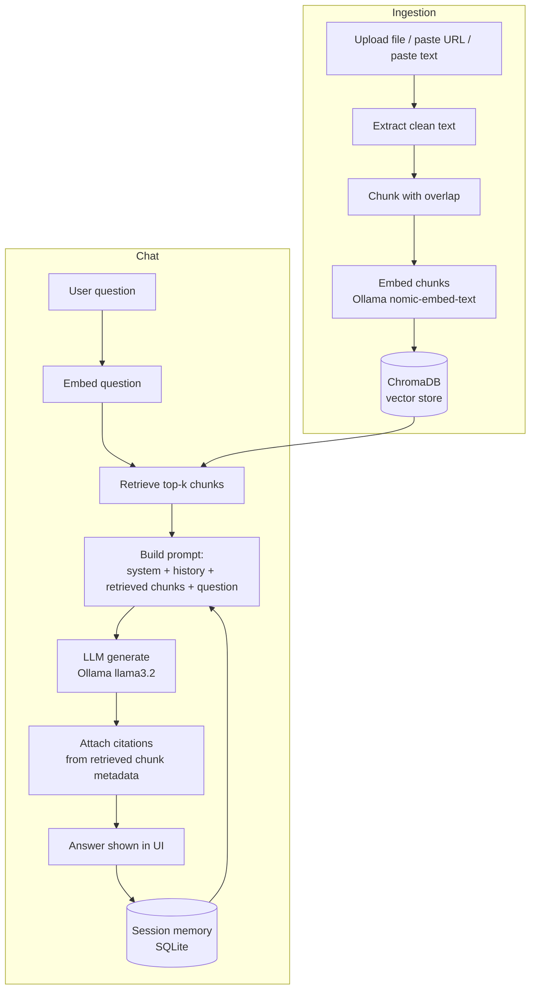

# DESIGN.md

## Product goal

A personal knowledge assistant that answers questions using documents you
actually gave it, and shows its work — every answer traces back to a
specific chunk of a specific source, so you can trust it or catch it when
it's wrong. Built to run entirely free, locally, for one person.

## Non-goals

- Not multi-user / multi-tenant — one person's knowledge base, one
  deployment, no accounts or permissions model.
- Not a general web-search chatbot. It only knows what you've fed it (plus
  whatever it fetches from a URL you explicitly give it).
- Not optimized for huge document collections (tens of thousands of docs)
  — ChromaDB's local mode is built for personal-scale knowledge bases, not
  enterprise search.
- Not trying to beat commercial RAG products on answer quality — trying to
  teach the real pattern behind them, correctly, for free.

## User flow

1. User uploads a document (or pastes a URL, or raw text).
2. The system extracts clean text, splits it into overlapping chunks,
   embeds each chunk locally, and stores the vectors + chunk text +
   source metadata in ChromaDB.
3. User asks a question in the chat UI.
4. The system embeds the question, retrieves the most similar chunks from
   the vector store, and builds a prompt containing only those chunks plus
   recent conversation history.
5. The LLM answers **using only the retrieved context**, and the system
   attaches citation markers mapping each part of the answer back to the
   specific source document and chunk.
6. The turn is saved to session memory so follow-ups work.

## Architecture (high level)

## Components

- **Ingestion** (`src/ingestion`): one loader per source type (`.txt`/`.md`
  read directly, `.pdf` via `pypdf`, URLs via `httpx` + `trafilatura` for
  clean text extraction), all normalized to plain text before chunking.
  The chunker (`src/utils/textsplit.py`) is a simple recursive
  character-based splitter with configurable size/overlap — simple, and
  transparent about what it's doing, which matters for a learning project.
- **Embeddings** (`src/embeddings`): one function, `embed(texts) ->
  list[vector]`, backed by Ollama's `/api/embed` endpoint. Swappable
  behind this interface if you want a cloud embedding provider later.
- **Vector store** (`src/vectorstore`): wraps a ChromaDB `PersistentClient`
  collection; stores chunk text + metadata (source filename, chunk index,
  original document title) alongside each vector so retrieval results
  carry everything needed for citation.
- **Agent** (`src/agent`): builds the RAG prompt (explicitly instructing
  the model to answer only from provided context and say so when the
  context doesn't cover the question), calls the LLM, and post-processes
  the response into `{answer, sources}` for the UI.
- **Memory** (`src/memory`): SQLite-backed per-session chat history, same
  pattern as a normal chat app — not part of the knowledge base itself.
- **Web UI** (`src/web`): one static HTML page, vanilla JS, calling the
  FastAPI JSON endpoints — no build step, no framework, easy to read and
  modify.

## Data flow / API boundaries

- All processing is in-process and local. The only network calls this
  system makes by default are to `localhost:11434` (Ollama) and, only when
  the user explicitly pastes a URL to ingest, to that one external URL.
- No data leaves the machine unless you point `LLM_BACKEND`/`EMBEDDING_
  BACKEND` at a cloud provider yourself.

## Security model

Covered in `SECURITY.md`. Summary: this is a single-user local tool with no
authentication by default, because it's designed to run on your own
machine. If you expose it to a network, you must add authentication
yourself — `SECURITY.md` explains exactly what and how.

## Failure modes

- **Ollama not running**: `/health` reports it; ingestion and chat fail
  with a clear error rather than hanging.
- **Unsupported file type uploaded**: rejected with a clear message rather
  than silently ingesting garbage.
- **Question has no relevant context**: the agent is explicitly prompted
  to say "I don't have information about that in your documents" rather
  than hallucinating an answer that looks well-cited but isn't.
- **URL fetch fails or is blocked**: reported to the user, not silently
  skipped.

## Scalability considerations

This is intentionally a single-process, single-user design. ChromaDB's
local persistent mode comfortably handles a personal knowledge base
(thousands of chunks); if you outgrow it, `ROADMAP.md` covers moving to a
ChromaDB server or a different vector database without changing anything
above the `src/vectorstore` interface.

## Cost considerations

Fully free by default — see `COSTS.md`.

## Technology choices and alternatives considered

| Decision | Chosen | Alternatives considered | Why |
|---|---|---|---|
| Vector database | ChromaDB (local, persistent) | Qdrant, FAISS, pgvector | Simplest local-first setup, Apache-2.0, no server process required for the default mode |
| Embeddings | Ollama `nomic-embed-text` | OpenAI embeddings, sentence-transformers directly | Free, local, and — per current benchmarks — competitive with paid cloud embeddings on retrieval quality for a 274MB model |
| LLM | Ollama `llama3.2` (swappable) | Cloud APIs | Free, local, private; swappable to Groq if hardware is too slow |
| Chunking | Simple recursive character splitter | Semantic/sentence-aware chunking, LangChain's splitters | Transparent and dependency-light; good enough for prose documents, and easy to understand/modify as a learning project |
| Web page extraction | `trafilatura` | BeautifulSoup alone, readability-lxml | Purpose-built for extracting clean article text from arbitrary web pages, actively maintained |
| Framework | Plain FastAPI + vanilla JS frontend | LangChain/LlamaIndex, a JS framework | Fewer abstraction layers between you and what's actually happening — better for learning the underlying pattern rather than a framework's API |
